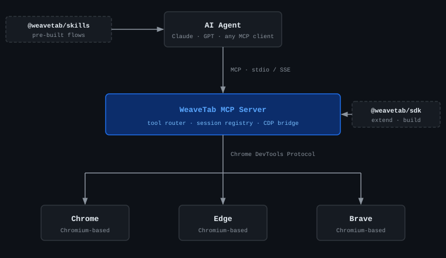

<div align="center">

<br/>

```
██╗    ██╗███████╗ █████╗ ██╗   ██╗███████╗████████╗ █████╗ ██████╗
██║    ██║██╔════╝██╔══██╗██║   ██║██╔════╝╚══██╔══╝██╔══██╗██╔══██╗
██║ █╗ ██║█████╗  ███████║██║   ██║█████╗     ██║   ███████║██████╔╝
██║███╗██║██╔══╝  ██╔══██║╚██╗ ██╔╝██╔══╝     ██║   ██╔══██║██╔══██╗
╚███╔███╔╝███████╗██║  ██║ ╚████╔╝ ███████╗   ██║   ██║  ██║██████╔╝
 ╚══╝╚══╝ ╚══════╝╚═╝  ╚═╝  ╚═══╝  ╚══════╝   ╚═╝   ╚═╝  ╚═╝╚═════╝
```

**Browser control infrastructure for AI agents.**

<br/>

[](https://badge.fury.io/js/weavetab)
[](https://badge.fury.io/js/@weavetab/skills)
[](https://weavetab.dev/docs)
[](https://weavetab.dev/changelog)

</div>

<br/>

WeaveTab is a browser control platform built for AI agents. The MCP server at its core connects any Chromium-based browser, Chrome, Edge, Brave, to any MCP-compatible agent runtime through a structured protocol layer. Agents call tools. The server translates them into Chrome DevTools Protocol commands and returns structured output against a live, persistent browser session.

The platform extends beyond the MCP server. WeaveTab ships a pre-built skills library for common browser flows, an SDK for building on top of the platform, and has a native browser extension and a purpose-built AI agent in active development.

<br/>

## How It Works

<picture>
  <source media="(prefers-color-scheme: dark)" srcset="diagram-dark.svg">
  
</picture>

The MCP server holds an open CDP session to a running Chromium instance. When an agent calls a tool, navigate, click, extract, evaluate, the server translates it into the appropriate CDP command sequence and returns structured output. Sessions persist across calls. Tabs are real. There is no screenshot pipeline, no DOM heuristic layer, no virtual display.

<br/>

## Platform

| Product | Install | Description | Status |
|---------|---------|-------------|--------|
| WeaveTab MCP | `npm i -g weavetab` | MCP server. Exposes Chrome, Edge, and Brave as structured, agent-callable browser tools via CDP. | stable |
| WeaveTab Skills | `npx @weavetab/skills` | Pre-built browser action library. Scraping, form interaction, and navigation flows, composable and agent-ready. | stable |
| WeaveTab SDK | `npm i @weavetab/sdk` | Developer layer for extending the platform and building custom browser tools. | in development |
| WeaveTab Extension | coming soon | Native browser extension with enhanced control surface, cross-origin coordination, and persistent injection. | planned |
| WeaveTab Agent | coming soon | Purpose-built AI agent with deep integration across the full WeaveTab platform. | planned |

<br/>

## Quickstart

**MCP Server**

```bash
npm install -g weavetab
```

```json
{
  "mcpServers": {
    "weavetab": {
      "command": "weavetab",
      "args": ["start"]
    }
  }
}
```

Your agent now has a live Chromium browser. Navigate, click, extract, and evaluate across any page, any tab, any session.

**Skills**

```bash
npx @weavetab/skills
```

<br/>

## Repositories

| Repository | Description |
|-----------|-------------|
| [`weavetab/mcp-builder`](https://github.com/weavetab/mcp-builder) | MCP server source. Tool definitions, CDP command layer, session registry. |
| [`weavetab/skills`](https://github.com/weavetab/skills) | Skills library source. Pre-composed browser flows, agent-ready. |
| [`weavetab/sdk`](https://github.com/weavetab/sdk) | SDK source. Developer surface for extending the platform. In development. |

<br/>

## Design Rationale

**MCP as the transport.** The Model Context Protocol gives agents a typed, discoverable interface to tools. Any MCP-compatible runtime connects to WeaveTab with no adapter code. The server is model-agnostic by design.

**CDP as the control layer.** Chrome DevTools Protocol provides unmediated access to what the browser is actually doing. Clicks land where CDP says they land. Evaluations run in the real page context. Network events are real network events. The control surface is exact.

**Chromium as the target.** Chrome, Edge, and Brave all expose the same CDP surface. WeaveTab targets the protocol, not the product. Whichever Chromium-based browser is running is the one the agent drives.

<br/>

## Resources

[Documentation](https://weavetab.dev/docs) . [Changelog](https://weavetab.dev/changelog) . [weavetab.dev](https://weavetab.dev)

<br/>

<div align="center">
<sub>built by <a href="https://github.com/fy2ne">@fy2ne</a></sub>
</div>
